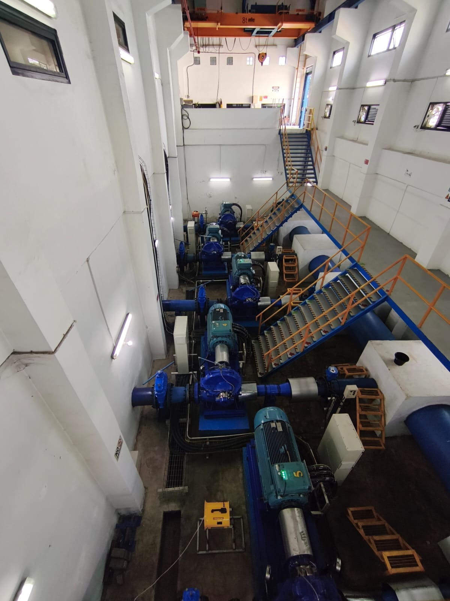
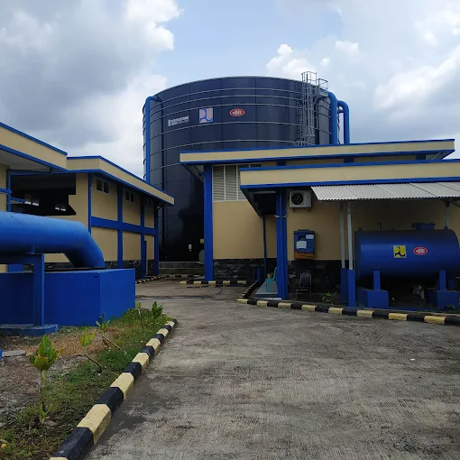
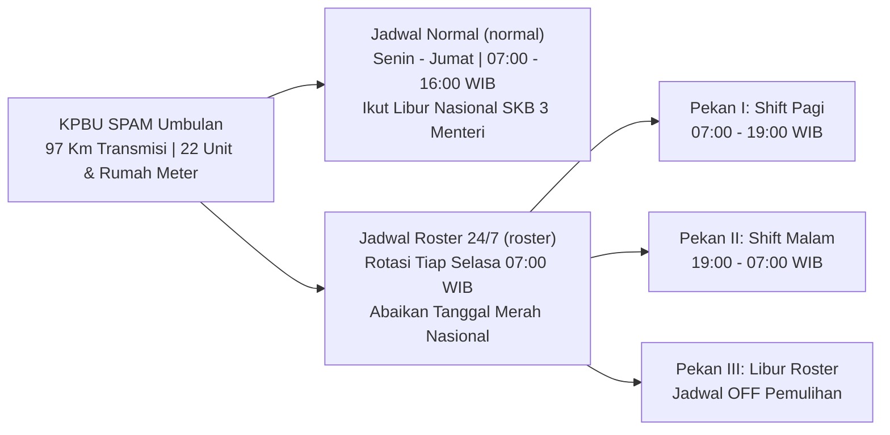
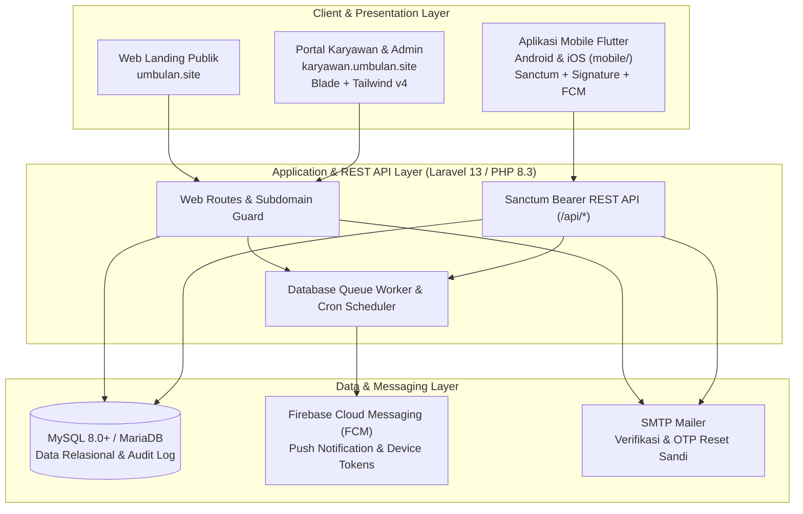
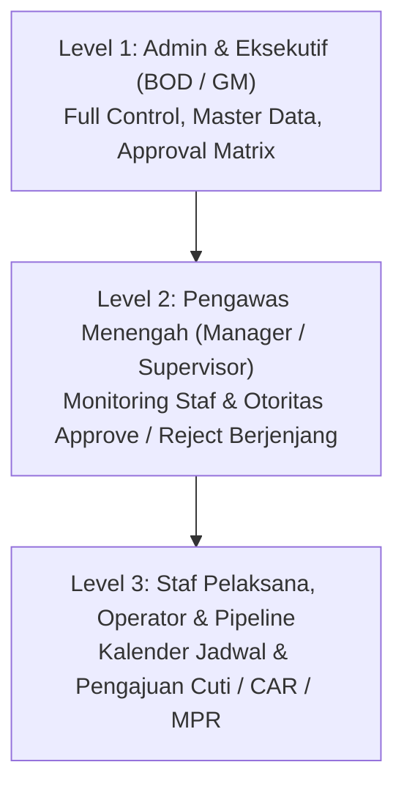
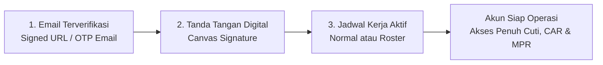
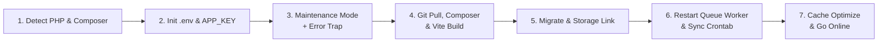

<div align="center">
  <a href="https://github.com/tumbaltok/Umbulan">
    
  </a>

  <h1>ERP META Adhya Tirta Umbulan</h1>

  <p>
    <strong>Water Transmission Enterprise System &amp; Operational Resource Planning</strong><br>
    <em>Badan Usaha Pelaksana Proyek Strategis Nasional KPBU SPAM Regional Umbulan</em>
  </p>

  <p>
    
    
    
    <br>
    
    
  </p>

  <p>
    <a href="#2-arsitektur-sistem--pemisahan-domain">Arsitektur</a> &bull;
    <a href="#4-pengaturan-profil-verifikasi-email--3-kriteria-kelayakan-akun">Akses &amp; 3-Syarat</a> &bull;
    <a href="#5-modul-pengajuan-cuti-validasi-kuota--kalibrasi-hari-libur">Cuti &amp; Pengadaan</a> &bull;
    <a href="#7-rest-api-sanctum-aplikasi-mobile-flutter--fcm">REST API &amp; Mobile</a> &bull;
    <a href="#9-panduan-pengembangan-lokal-web--mobile-flutter">Setup Lokal</a> &bull;
    <a href="#10-panduan-deployment-server-produksi">Deploy Produksi</a>
  </p>

  <br>

  <table>
    <tr>
      <td align="center" width="33%">
        <br>
        <sub><strong>Transmisi Air Bersih 97 Km</strong><br>Pipa Utama &amp; Surge Tank (Dok. PT PII)</sub>
      </td>
      <td align="center" width="33%">
        <br>
        <sub><strong>2 Stasiun Utama / Booster</strong><br>Rumah Pompa Operasional 24/7</sub>
      </td>
      <td align="center" width="33%">
        <br>
        <sub><strong>18 Rumah Meter Offtake</strong><br>Pasuruan &ndash; Sidoarjo &ndash; Surabaya &ndash; Gresik</sub>
      </td>
    </tr>
  </table>
  <p>
    <sub><em>Dokumentasi asli fasilitas operasional <strong>PT META Adhya Tirta Umbulan</strong> (KPBU SPAM Regional Umbulan &ndash; 4.000 L/detik)</em></sub>
  </p>
</div>

---

> [!NOTE]
> **Single Source of Truth:** Seluruh arsitektur, alur logika bisnis, REST API Sanctum, aplikasi Mobile Flutter (`mobile/`), dan panduan deployment pada dokumen ini disinkronkan langsung dengan implementasi kode terkini (**47/47 PHPUnit Tests, 2/2 Flutter Tests & Flutter Analyze Clean**).

### ✨ Ringkasan Kapabilitas Utama

<table>
  <tr>
    <td width="50%" valign="top">
      <strong>📅 Dual-Pattern Jadwal Kerja &amp; SKB 3 Menteri</strong><br>
      Mendukung pola <strong>Normal (Senin&ndash;Jumat)</strong> terkalibrasi hari libur nasional SKB 3 Menteri dan <strong>Roster 24/7 (3 Pekan)</strong> sebagai basis perhitungan hari efektif cuti, kalender kerja, serta penjadwalan notifikasi tindak lanjut atasan.
    </td>
    <td width="50%" valign="top">
      <strong>🔐 3 Kriteria Kelayakan Akun &amp; TTD Digital</strong><br>
      Kewajiban verifikasi <strong>Email OTP</strong>, <strong>Tanda Tangan Digital</strong> (unggah atau kanvas dengan penghapusan latar transparan), serta <strong>Jadwal Kerja Aktif</strong> sebelum dapat mengajukan dokumen dinas.
    </td>
  </tr>
  <tr>
    <td width="50%" valign="top">
      <strong>🏛️ Approval Matrix &amp; PDF Resmi</strong><br>
      Pengajuan <strong>Cuti</strong>, <strong>CAR (Cash Advance)</strong>, dan <strong>MPR (Material Purchase)</strong> berjenjang dinamis per jabatan, proteksi anti-kolusi, tanda tangan digital Base64, dan cetak dokumen PDF A4 resmi via DomPDF.
    </td>
    <td width="50%" valign="top">
      <strong>📱 Portal Subdomain, REST API &amp; FCM</strong><br>
      Pemisahan landing publik dan portal karyawan (<code>karyawan.*</code>), autentikasi Email OTP + Sanctum Bearer Token, aplikasi mobile Android/iOS, serta notifikasi *real-time* via Firebase Cloud Messaging (FCM).
    </td>
  </tr>
</table>

<details>
<summary><strong>📑 Buka Daftar Isi Lengkap</strong></summary>

- [1. Tujuan & Ruang Lingkup Sistem](#1-tujuan--ruang-lingkup-sistem)
- [2. Arsitektur Sistem & Pemisahan Domain](#2-arsitektur-sistem--pemisahan-domain)
- [3. Hirarki Hak Akses & Matriks Persetujuan Dinamis](#3-hirarki-hak-akses--matriks-persetujuan-dinamis)
- [4. Pengaturan Profil, Verifikasi Email & 3 Kriteria Kelayakan Akun](#4-pengaturan-profil-verifikasi-email--3-kriteria-kelayakan-akun)
- [5. Modul Pengajuan Cuti, Validasi Kuota & Kalibrasi Hari Libur](#5-modul-pengajuan-cuti-validasi-kuota--kalibrasi-hari-libur)
- [6. Modul CAR (Cash Advance) & MPR (Material Purchase)](#6-modul-car-cash-advance--mpr-material-purchase)
- [7. REST API Sanctum, Aplikasi Mobile Flutter & FCM](#7-rest-api-sanctum-aplikasi-mobile-flutter--fcm)
- [8. Automasi Latar Belakang (Task Scheduler & Cron Jobs)](#8-automasi-latar-belakang-task-scheduler--cron-jobs)
- [9. Panduan Pengembangan Lokal (Web & Mobile Flutter)](#9-panduan-pengembangan-lokal-web--mobile-flutter)
- [10. Panduan Deployment Server Produksi](#10-panduan-deployment-server-produksi)

</details>

---

## 1. Tujuan & Ruang Lingkup Sistem

Sistem mengelola administrasi pengajuan Cuti/Izin, Cash Advance Request (`CAR`), dan Material Purchase Request (`MPR`) untuk pegawai administratif maupun operator lapangan sepanjang 97 kilometer (Kab. Pasuruan hingga Kab. Gresik) berbasis **2 Pola Jadwal Kerja Baku** yang terkunci di [ScheduleService.php](app/Services/ScheduleService.php):



| Parameter | Tipe 1: Normal (`normal`) | Tipe 2: Roster / Shift (`roster`) |
| :--- | :--- | :--- |
| **Label Antarmuka** | `Normal (Senin – Jumat)` | `Roster / Shift (12 Jam)` |
| **Pola Hari Kerja** | Senin s/d Jumat (Sabtu & Minggu OFF) | Siklus 3 Pekan (Pagi, Malam, OFF Roster) |
| **Jam Kerja Baku** | `07:00` – `16:00` WIB | Pagi: `07:00`–`19:00` \| Malam: `19:00`–`07:00` WIB |
| **Hari Libur Nasional** | Otomatis libur sesuai SKB 3 Menteri | Tetap dinas operasional 24/7 (cuti mengikuti hari shift aktif) |

---

## 2. Arsitektur Sistem & Pemisahan Domain

### A. Diagram Arsitektur Multi-Tier



### B. Pemisahan Subdomain ([routes/web.php](routes/web.php))
* **`APP_MAIN_DOMAIN=umbulan.site`:** Menyajikan halaman informasi publik korporat (`welcome.blade.php`) di rute `/`.
* **`APP_PORTAL_DOMAIN=karyawan.umbulan.site` (`PORTAL_SUBDOMAIN_MODE=auto`):** Permintaan ke host `karyawan.*` pada rute `/` otomatis mengarahkan pengguna ke `/login` atau `/dashboard`.

### C. Stack Teknologi & Pustaka Inti

| Komponen / Pustaka | Versi | Peran & Lokasi Implementasi |
| :--- | :---: | :--- |
| **PHP & Laravel** | `^8.3` / `^13.8` | Core MVC, REST API, Eloquent ORM, Queue, Scheduler ([composer.json](composer.json)). |
| **Laravel Sanctum** | `^4.0` | Token API berbasis Bearer untuk aplikasi Flutter ([routes/api.php](routes/api.php)). |
| **Barryvdh DomPDF** | `^3.1 / ^4.0` | Generator PDF resmi A4 untuk Cuti, CAR, dan MPR dengan TTD digital inline. |
| **PHP GD Extension** | Bawaan PHP | Penghapusan latar belakang transparan berkas Tanda Tangan Digital ([AccountController.php](app/Http/Controllers/User/AccountController.php)). |
| **Tailwind CSS v4** | `^4.0` | Styling antarmuka Web via `@tailwindcss/vite` dengan Dark/Light Mode adaptif. |
| **Flutter SDK** | `^3.14.0` | Aplikasi mobile [mobile/](mobile/) (`dio`, `provider`, `shared_preferences`, `signature`, `file_picker`, `firebase_messaging`, `flutter_local_notifications`). |
| **Push & Holiday Service** | Internal | `PushNotificationService` (In-App + FCM) & `HolidayService` (sinkronisasi SKB 3 Menteri). |

---

## 3. Hirarki Hak Akses & Matriks Persetujuan Dinamis

Sistem memadukan otorisasi **Level Pengguna (`users.level` 1–3)** dengan **Role Approval Matrix (`roles.approval_rules`)** yang dapat diatur langsung oleh Administrator per jabatan ([RoleController.php](app/Http/Controllers/Admin/RoleController.php)).



* **Konfigurasi Mandiri per Modul:** Setiap role menyimpan konfigurasi JSON terpisah untuk `cuti`, `car`, dan `mpr` (`levels`: 1 atau 2 tahap beserta `approver_1_role_id` dan `approver_2_role_id`).
* **Proteksi Integritas Persetujuan:**
  1. **Self-Approval Protection:** Pemohon dilarang menyetujui dokumennya sendiri (`user_id != approver_id`).
  2. **Anti-Collusion Multi-Stage Guard:** Approver Tahap 1 tidak dapat menjadi Approver Tahap 2 pada dokumen yang sama.
  3. **Top-Level Auto Approval:** Jika role pemohon tidak memiliki atasan/approver, pengajuan otomatis berstatus `approved`.
  4. **First-to-Act Rejection:** Penolakan pada tahap apa pun menggugurkan pengajuan (`rejected`), mewajibkan `catatan_penolakan`, dan memblokir pencetakan PDF.

---

## 4. Pengaturan Profil, Verifikasi Email & 3 Kriteria Kelayakan Akun

Identitas login, verifikasi kepemilikan akun, dan pemulihan kata sandi sepenuhnya menggunakan **Email Kepegawaian** (tanpa ketergantungan nomor telepon/WhatsApp).



* **Guard Kelengkapan Akun ([EnsureAccountIsComplete.php](app/Http/Middleware/EnsureAccountIsComplete.php)):** Middleware `account.complete` menolak akses pengajuan Cuti, CAR, dan MPR dengan respons `HTTP 403` (API) atau redirect + alert (Web) sampai ke-3 syarat di atas terpenuhi.
* **Lupa Kata Sandi ([ForgotPasswordController.php](app/Http/Controllers/Auth/ForgotPasswordController.php)):** Mendukung identifikasi via Email atau NIP dengan perlindungan *anti-account enumeration*, pengiriman OTP 6-digit ke Email (`PasswordResetOtpMail`), *rate limiting*, *cooldown* 60 detik, kedaluwarsa 5 menit, dan lockout 5x salah input.
* **Integritas Profil & Jadwal ([AccountController.php](app/Http/Controllers/User/AccountController.php)):** Penguncian `gender_id` hanya dapat diubah oleh Admin Level 1; mendukung penugasan multi-jabatan (`role_user`), multi-Rumah Meter (`station_user`), dan pengaturan Jadwal Kerja (`Normal` atau `Roster`).

---

## 5. Modul Pengajuan Cuti, Validasi Kuota & Kalibrasi Hari Libur

* **Kalibrasi SKB 3 Menteri ([HolidayService.php](app/Services/HolidayService.php)):** Caching tabel `holidays` 24 jam, auto-sync berkala, baseline darurat offline, serta perlindungan data manual admin (`source = 'manual_admin'`).
* **Pemotongan Saldo Adil ([CutiHelperTrait.php](app/Traits/CutiHelperTrait.php)):**
  * Jadwal Normal menghitung hari efektif Senin–Jumat di luar tanggal merah nasional; Jadwal Roster menghitung sesuai hari dinas aktif di luar libur Roster Pekan III.
  * Hanya **Cuti Tahunan (`CT`)** yang memotong saldo (dilindungi `is_cut_saldo`); **Cuti Haid** khusus wanita dibatasi **2 hari/bulan kalender**.
  * Pengajuan cuti yang disetujui otomatis memotong kuota terkait dan langsung terefleksi di Kalender Jadwal Kerja karyawan.

---

## 6. Modul CAR (Cash Advance) & MPR (Material Purchase)

| Aspek | Cash Advance Request (`CAR`) | Material Purchase Request (`MPR`) |
| :--- | :--- | :--- |
| **Format Nomor Baku** | `[No] / META / PAS / CAR / [Bulan Romawi] / [Tahun]` | `[No] / META / PAS / MPR / [Bulan Romawi] / [Tahun]` |
| **Data Utama** | Rincian item, kuantitas, harga satuan, ongkir, rekening pencairan | Prioritas (`Normal`/`Urgent`/`Emergency`), *delivery point*, spesifikasi item |
| **Keamanan & Cetak** | *Immutable* pasca submit, PDF A4 resmi ([DokumenCarController.php](app/Http/Controllers/Car/DokumenCarController.php)) | Persetujuan 2 tahap + Procurement, PDF resmi ([DokumenMprController.php](app/Http/Controllers/Mpr/DokumenMprController.php)) |

---

## 7. REST API Sanctum, Aplikasi Mobile Flutter & FCM

Seluruh komunikasi antara aplikasi Flutter Android/iOS ([mobile/](mobile/)) dan server menggunakan endpoint REST API berikut ([routes/api.php](routes/api.php)):

<details>
<summary><strong>📡 Daftar Endpoint REST API (<code>/api/*</code>)</strong></summary>

| Kategori | Method | Endpoint | Auth / Guard | Fungsi |
| :--- | :---: | :--- | :---: | :--- |
| **Auth & Akun** | `POST` | `/api/login`, `/api/register` | Publik | Login Sanctum (plus simpan `fcm_token`) & registrasi |
| **Master & OTP** | `GET` / `POST` | `/api/master-data`, `/api/forgot-password/*` | Publik | Daftar role/stasiun & reset sandi OTP email |
| **Sesi & Profil** | `GET` / `POST` | `/api/me`, `/api/logout`, `/api/email/*` | `auth:sanctum` | Profil + 3-kriteria status, verifikasi email OTP, cabut token |
| **Dashboard** | `GET` | `/api/dashboard`, `/api/calendar` | `auth:sanctum` | Ringkasan jadwal hari ini, kuota cuti, kalender kerja & histori |
| **Kesiapan Akun** | `PUT` / `POST` | `/api/user/schedule`, `/api/user/signature` | `auth:sanctum` | Pengaturan jadwal kerja & unggah tanda tangan digital |
| **Pengajuan** | `GET` / `POST` | `/api/cuti`, `/api/car`, `/api/mpr` | `auth:sanctum` + `account.complete` | Daftar & pengajuan transaksi (wajib 3 kriteria akun) |
| **Notifikasi FCM** | `POST` / `GET` | `/api/devices/fcm-token`, `/api/notifications/*` | `auth:sanctum` | Registrasi token perangkat FCM & kotak masuk notifikasi |

</details>

* **In-App + FCM Push ([PushNotificationService.php](app/Services/PushNotificationService.php)):** Notifikasi pengajuan baru, tindak lanjut (`follow_up`), dan keputusan approval disimpan ke tabel `notifications` dan dikirimkan via `SendPushNotification` ke seluruh token perangkat pengguna pada `user_devices`.

---

## 8. Automasi Latar Belakang (Task Scheduler & Cron Jobs)

Dikonfigurasi deklaratif di [routes/console.php](routes/console.php) dan dipicu setiap menit melalui Crontab:

| Perintah Artisan | Jadwal (WIB) | Fungsi |
| :--- | :---: | :--- |
| `saldo:reset-haid` | Tgl 1 tiap bulan, `00:00` | Mengatur ulang kuota Cuti Haid bulanan menjadi 2 hari bagi karyawan perempuan aktif. |
| `saldo:reset-tahunan` | Tgl 1 Januari, `00:00` | Menginisialisasi kuota 12 hari kerja Cuti Tahunan (`CT`) untuk tahun baru. |
| `holiday:sync` | 1 Jan `00:05` & Tgl 1 `01:00` | Menyinkronkan daftar hari libur nasional & cuti bersama SKB 3 Menteri. |
| `pengajuan:followup-notif` | Setiap `10 menit` | Mengirim pengingat In-App & FCM Push atas pengajuan pending pada jam kerja aktif atasan. |

---

## 9. Panduan Pengembangan Lokal (Web & Mobile Flutter)

### A. Backend & Web Portal (Laravel)

```bash
git clone https://github.com/tumbaltok/Umbulan.git
cd Umbulan
composer install
npm install
cp .env.example .env
php artisan key:generate
```

Sesuaikan koneksi MySQL dan pengaturan domain lokal di `.env`, lalu jalankan migrasi dan server pengembangan:

```bash
php artisan migrate
php artisan storage:link
npm run build
php artisan serve --host=0.0.0.0 --port=8000
php artisan queue:listen
```

> [!TIP]
> **Akun Testing Lokal (Opsional):** Migrasi utama menganut *Zero-User Initial State* (hanya menanamkan 22 stasiun & 26 role jabatan). Untuk pengujian lokal dengan cepat, jalankan seeder [TestUserSeeder.php](database/seeders/TestUserSeeder.php):
> ```bash
> php artisan db:seed --class=TestUserSeeder
> ```
> Seeder ini membuat akun `admin@umbulan.site` (Level 1) dan `karyawan@umbulan.site` (Level 3) dengan kata sandi `Password123!`. Jangan jalankan di server produksi.

Jalankan seluruh pengujian backend:
```bash
php artisan test
```

### B. Aplikasi Mobile Flutter ([mobile/](mobile/))

```bash
cd mobile
flutter pub get
flutter analyze
flutter test
flutter run                                    # Debug ke Emulator / HP USB
flutter build apk --release --split-per-abi    # APK produksi per arsitektur CPU
```

---

## 10. Panduan Deployment Server Produksi

> [!IMPORTANT]
> Gunakan placeholder aman (`domain-anda.com`, `nama_database_anda`, `password_database_kuat`) saat mengatur server produksi dan jangan pernah men-commit berkas `.env` maupun kunci Service Account Firebase (`storage/app/firebase-*.json`) ke repositori publik.

### 10.0. ⚡ Jalur Cepat: One-Click Auto-Deployer (`deploy.sh`)

Skrip [deploy.sh](deploy.sh) dirancang *idempotent* untuk deployment perdana maupun pembaruan kode rutin di Ubuntu/Debian VPS dan **aaPanel**:



**Panduan Deploy 3 Langkah di aaPanel:**
1. Buat Website baru (**PHP 8.3**) dengan mengarahkan `domain-anda.com` dan `karyawan.domain-anda.com` ke direktori proyek yang sama, serta siapkan database MySQL.
2. Kloning repositori ke root website dan jalankan:
   ```bash
   bash deploy.sh
   ```
3. Pada menu **Site directory** di aaPanel, arahkan **Running directory** ke **`/public`** dan simpan.

---

<details>
<summary><strong>🛠️ 10.1 – 10.12. Panduan Manual Step-by-Step Ubuntu 22.04 / 24.04 LTS + Nginx</strong></summary>

1. **Firewall UFW & Paket Dasar:**
   ```bash
   sudo apt update && sudo apt upgrade -y
   sudo apt install -y curl git unzip zip software-properties-common ca-certificates gnupg ufw supervisor nginx certbot python3-certbot-nginx
   sudo ufw default deny incoming && sudo ufw default allow outgoing
   sudo ufw allow 22/tcp && sudo ufw allow 80/tcp && sudo ufw allow 443/tcp
   sudo ufw --force enable
   ```
2. **PHP 8.3 & Ekstensi Wajib (`gd`, `mysql`, `xml`, `bcmath`, `curl`, `intl`, `sqlite3`, `mbstring`, `zip`):**
   ```bash
   sudo add-apt-repository ppa:ondrej/php -y && sudo apt update
   sudo apt install -y php8.3 php8.3-fpm php8.3-cli php8.3-common php8.3-mysql php8.3-mbstring php8.3-xml php8.3-bcmath php8.3-curl php8.3-gd php8.3-zip php8.3-intl php8.3-sqlite3
   ```
3. **Composer 2 & Node.js 20 LTS (untuk Vite):**
   ```bash
   curl -sS https://getcomposer.org/installer | php && sudo mv composer.phar /usr/local/bin/composer
   curl -fsSL https://deb.nodesource.com/setup_20.x | sudo -E bash - && sudo apt install -y nodejs
   ```
4. **Database MySQL:**
   ```sql
   CREATE DATABASE nama_database_anda CHARACTER SET utf8mb4 COLLATE utf8mb4_unicode_ci;
   CREATE USER 'nama_user_database'@'127.0.0.1' IDENTIFIED BY 'password_database_kuat';
   GRANT ALL PRIVILEGES ON nama_database_anda.* TO 'nama_user_database'@'127.0.0.1';
   FLUSH PRIVILEGES;
   ```
5. **Instalasi Proyek & `.env` Produksi:**
   ```dotenv
   APP_NAME="META Adhya Tirta Umbulan"
   APP_ENV=production
   APP_DEBUG=false
   APP_URL=https://domain-anda.com
   APP_MAIN_DOMAIN=domain-anda.com
   APP_PORTAL_DOMAIN=karyawan.domain-anda.com
   PORTAL_SUBDOMAIN_MODE=auto

   DB_CONNECTION=mysql
   DB_HOST=127.0.0.1
   DB_PORT=3306
   DB_DATABASE=nama_database_anda
   DB_USERNAME=nama_user_database
   DB_PASSWORD=password_database_kuat

   SESSION_DRIVER=file
   CACHE_STORE=database
   QUEUE_CONNECTION=database
   FILESYSTEM_DISK=public

   MAIL_MAILER=smtp
   MAIL_HOST=smtp.domain-anda.com
   MAIL_PORT=587
   MAIL_USERNAME=username_smtp_anda
   MAIL_PASSWORD=password_smtp_anda
   MAIL_FROM_ADDRESS="no-reply@domain-anda.com"
   MAIL_FROM_NAME="${APP_NAME}"

   FCM_PROJECT_ID=id-project-firebase-anda
   FCM_CREDENTIALS=/var/www/umbulan/storage/app/firebase-service-account.json
   FCM_SERVER_KEY=
   ```
   ```bash
   composer install --no-dev --optimize-autoloader --no-interaction
   npm ci && npm run build
   php artisan key:generate --force
   php artisan migrate --force
   php artisan storage:link
   sudo chown -R www-data:www-data /var/www/umbulan && sudo chmod -R 775 storage bootstrap/cache
   ```
6. **Supervisor Queue Worker (`/etc/supervisor/conf.d/umbulan-worker.conf`) & Crontab:**
   ```ini
   [program:umbulan-worker]
   process_name=%(program_name)s_%(process_num)02d
   command=php /var/www/umbulan/artisan queue:work database --sleep=3 --tries=3 --max-time=3600 --timeout=90
   autostart=true
   autorestart=true
   stopasgroup=true
   killasgroup=true
   user=www-data
   numprocs=2
   redirect_stderr=true
   stdout_logfile=/var/www/umbulan/storage/logs/queue-worker.log
   stopwaitsecs=3600
   ```
   ```cron
   * * * * * cd /var/www/umbulan && php artisan schedule:run >> /dev/null 2>&1
   ```
7. **Konfigurasi Nginx Multi-Domain (`/etc/nginx/sites-available/umbulan.conf`):**
   ```nginx
   server {
       listen 80;
       listen [::]:80;
       server_name domain-anda.com karyawan.domain-anda.com;
       return 301 https://$host$request_uri;
   }

   server {
       listen 443 ssl http2;
       listen [::]:443 ssl http2;
       server_name domain-anda.com karyawan.domain-anda.com;

       root /var/www/umbulan/public;
       index index.php index.html;
       charset utf-8;
       client_max_body_size 50M;

       add_header X-Frame-Options "SAMEORIGIN" always;
       add_header X-XSS-Protection "1; mode=block" always;
       add_header X-Content-Type-Options "nosniff" always;
       add_header Referrer-Policy "no-referrer-when-downgrade" always;

       location / {
           try_files $uri $uri/ /index.php?$query_string;
       }

       location ~* \.(jpg|jpeg|png|gif|ico|css|js|woff|woff2|ttf|svg|webp)$ {
           expires 30d;
           add_header Cache-Control "public, no-transform";
           access_log off;
       }

       location ^~ /storage/ {
           location ~ \.(php|phar|phtml|sh|py|pl|cgi)$ { deny all; return 404; }
       }

       location ~ \.php$ {
           fastcgi_pass unix:/run/php/php8.3-fpm.sock;
           fastcgi_param SCRIPT_FILENAME $realpath_root$fastcgi_script_name;
           include fastcgi_params;
           fastcgi_hide_header X-Powered-By;
           fastcgi_read_timeout 300;
       }

       location ~ /\.(?!well-known).* { deny all; }
       location ~* /(composer\.(json|lock)|package(-lock)?\.json|\.env.*)$ { deny all; }
   }
   ```
   ```bash
   sudo ln -s /etc/nginx/sites-available/umbulan.conf /etc/nginx/sites-enabled/
   sudo rm -f /etc/nginx/sites-enabled/default
   sudo nginx -t && sudo systemctl reload nginx
   sudo certbot --nginx -d domain-anda.com -d karyawan.domain-anda.com
   php artisan optimize:clear && php artisan optimize && php artisan view:cache
   ```

</details>

<details>
<summary><strong>📄 10.13. Lihat Kode Lengkap Skrip <code>deploy.sh</code></strong></summary>

```bash
#!/usr/bin/env bash
# ==============================================================================
# ERP META ADHYA TIRTA UMBULAN - UNIVERSAL ONE-CLICK PRODUCTION DEPLOYER
# Dioptimalkan khusus untuk aaPanel, Ubuntu/Debian VPS, dan On-Premise Server
# ==============================================================================
set -e

APP_DIR="$(cd "$(dirname "${BASH_SOURCE[0]}")" && pwd)"
cd "$APP_DIR"

echo "=================================================================="
echo "  🚀 MEMULAI ONE-CLICK DEPLOYMENT: ERP META ADHYA TIRTA UMBULAN   "
echo "  📁 Lokasi Proyek: $APP_DIR                                      "
echo "=================================================================="

if [ -f "/www/server/php/83/bin/php" ]; then
    PHP_BIN="/www/server/php/83/bin/php"
elif [ -f "/www/server/php/84/bin/php" ]; then
    PHP_BIN="/www/server/php/84/bin/php"
elif [ -f "/www/server/php/82/bin/php" ]; then
    PHP_BIN="/www/server/php/82/bin/php"
elif command -v php >/dev/null 2>&1; then
    PHP_BIN="php"
else
    echo "❌ [ERROR] PHP tidak ditemukan di sistem. Harap install PHP 8.3 terlebih dahulu."
    exit 1
fi
echo "🐘 [PHP] Menggunakan interpreter: $($PHP_BIN -v | head -n 1)"

if command -v composer >/dev/null 2>&1; then
    COMPOSER_CMD="composer"
elif [ -f "/www/server/php/83/bin/composer" ]; then
    COMPOSER_CMD="$PHP_BIN /www/server/php/83/bin/composer"
elif [ -f "$APP_DIR/composer.phar" ]; then
    COMPOSER_CMD="$PHP_BIN $APP_DIR/composer.phar"
else
    echo "📥 [COMPOSER] Mengunduh composer.phar otomatis..."
    curl -sS https://getcomposer.org/installer | $PHP_BIN
    COMPOSER_CMD="$PHP_BIN $APP_DIR/composer.phar"
fi

if [ ! -f "$APP_DIR/.env" ]; then
    echo "📝 [ENV] File .env belum ditemukan. Menginisialisasi otomatis dari .env.example..."
    cp "$APP_DIR/.env.example" "$APP_DIR/.env"

    if [ -t 0 ]; then
        echo ""
        echo "------------------------------------------------------------------"
        echo "  🛠️  SETUP DATABASE CEPAT (Tekan ENTER untuk lewati / edit manual nanti)"
        echo "------------------------------------------------------------------"
        read -p "  👉 Nama Database MySQL di aaPanel : " INPUT_DB_NAME
        read -p "  👉 Username Database MySQL         : " INPUT_DB_USER
        read -sp "  👉 Password Database MySQL         : " INPUT_DB_PASS
        echo ""

        if [ -n "$INPUT_DB_NAME" ]; then
            sed -i "s/^DB_DATABASE=.*/DB_DATABASE=$INPUT_DB_NAME/" "$APP_DIR/.env"
        fi
        if [ -n "$INPUT_DB_USER" ]; then
            sed -i "s/^DB_USERNAME=.*/DB_USERNAME=$INPUT_DB_USER/" "$APP_DIR/.env"
        fi
        if [ -n "$INPUT_DB_PASS" ]; then
            ESCAPED_PASS=$(printf '%s\n' "$INPUT_DB_PASS" | sed -e 's/[\/&]/\\&/g')
            sed -i "s/^DB_PASSWORD=.*/DB_PASSWORD=$ESCAPED_PASS/" "$APP_DIR/.env"
        fi
        echo "  ✅ Kredensial database berhasil disimpan ke file .env"
        echo "------------------------------------------------------------------"
    else
        echo "⚠️ [PENTING] File .env telah dibuat dari template. Sesuaikan kredensial DB di file .env."
    fi
fi

cleanup() {
    EXIT_CODE=$?
    if [ $EXIT_CODE -ne 0 ]; then
        echo ""
        echo "❌ [DEPLOY ERROR] Terjadi kegagalan pada status code $EXIT_CODE!"
        echo "🔄 Memastikan status aplikasi kembali ONLINE..."
        if [ -d "$APP_DIR/vendor" ]; then
            $PHP_BIN artisan up 2>/dev/null || true
        fi
    fi
}
trap cleanup EXIT ERR

if [ -d "$APP_DIR/vendor" ] && [ -f "$APP_DIR/vendor/autoload.php" ]; then
    BYPASS_SECRET=$(openssl rand -hex 16 2>/dev/null || echo "umbulan_maint_$(date +%s)")
    echo "🔒 [1/11] Mengaktifkan Mode Pemeliharaan Sementara..."
    echo "🔑 Bypass Token: $BYPASS_SECRET"
    $PHP_BIN artisan down --render="errors::503" --secret="$BYPASS_SECRET" 2>/dev/null || true
else
    echo "✨ [1/11] Inisialisasi awal instalasi (mode pemeliharaan dilewati)..."
fi

if [ -d "$APP_DIR/.git" ]; then
    echo "📥 [2/11] Memeriksa pembaruan kode Git..."
    git pull origin main 2>/dev/null || git pull 2>/dev/null || echo "ℹ️ Git pull dilewati atau sudah versi terbaru."
fi

echo "📦 [3/11] Memasang dependensi PHP (Composer)..."
$COMPOSER_CMD install --no-dev --optimize-autoloader --no-interaction

if ! grep -q "^APP_KEY=base64:" "$APP_DIR/.env"; then
    echo "🔑 [4/11] Menghasilkan APP_KEY produksi baru..."
    $PHP_BIN artisan key:generate --force
fi

if command -v npm >/dev/null 2>&1 && [ -f "$APP_DIR/package.json" ]; then
    echo "🎨 [5/11] Membangun asset frontend Vite & Tailwind CSS..."
    npm ci 2>/dev/null || npm install --no-audit --no-fund
    npm run build
fi

echo "🔔 [6/11] Notifikasi menggunakan Push Notification APK & Database Notifications..."

echo "🗄️ [7/11] Memeriksa koneksi database & menjalankan migrasi..."
if $PHP_BIN artisan migrate:status >/dev/null 2>&1; then
    $PHP_BIN artisan migrate --force
    echo "✅ Database berhasil dimigrasikan."
else
    echo "⚠️ [PERINGATAN] Database belum dapat dihubungi. Pastikan DB_DATABASE, DB_USERNAME, dan DB_PASSWORD pada file .env sudah sesuai dengan database server Anda."
fi

echo "🔗 [8/11] Memastikan Symlink Storage Aktif..."
$PHP_BIN artisan storage:link 2>/dev/null || true

echo "⚙️ [9/11] Mengonfigurasi Laravel Queue Worker..."
if command -v pm2 >/dev/null 2>&1; then
    if pm2 describe umbulan-worker >/dev/null 2>&1; then
        pm2 restart umbulan-worker
    else
        pm2 start "$PHP_BIN artisan queue:work --tries=3 --timeout=90" --name umbulan-worker
    fi
    pm2 save 2>/dev/null || true
fi

if command -v supervisorctl >/dev/null 2>&1; then
    sudo supervisorctl restart umbulan-worker:* 2>/dev/null || supervisorctl restart umbulan-worker:* 2>/dev/null || true
fi

echo "⏰ [10/11] Mengonfigurasi Crontab Otomatis untuk Laravel Scheduler..."
CRON_CMD="* * * * * cd $APP_DIR && $PHP_BIN artisan schedule:run >> /dev/null 2>&1"
CURRENT_CRON=$(crontab -l 2>/dev/null || true)

if echo "$CURRENT_CRON" | grep -Fq "$APP_DIR"; then
    echo "✅ Crontab Laravel Scheduler sudah aktif."
else
    echo "➕ Mendaftarkan Laravel Scheduler ke Crontab sistem..."
    (echo "$CURRENT_CRON"; echo "$CRON_CMD") | crontab -
    echo "✅ Berhasil mendaftarkan Scheduler (Reset Saldo Bulanan, Tahunan, & Push Notif aktif otomatis)."
fi

echo "⚡ [11/11] Mengoptimalkan cache sistem & menyesuaikan izin folder..."
$PHP_BIN artisan optimize:clear 2>/dev/null || true
$PHP_BIN artisan optimize 2>/dev/null || true
$PHP_BIN artisan view:cache 2>/dev/null || true

chmod -R 775 "$APP_DIR/storage" "$APP_DIR/bootstrap/cache" 2>/dev/null || true
if id "www" >/dev/null 2>&1; then
    chown -R www:www "$APP_DIR/storage" "$APP_DIR/bootstrap/cache" 2>/dev/null || true
elif id "www-data" >/dev/null 2>&1; then
    chown -R www-data:www-data "$APP_DIR/storage" "$APP_DIR/bootstrap/cache" 2>/dev/null || true
fi

$PHP_BIN artisan up 2>/dev/null || true
trap - EXIT ERR

echo ""
echo "=================================================================="
echo "  🎉 ONE-CLICK DEPLOYMENT SELESAI & SISTEM SIAP DIGUNAKAN!        "
echo "=================================================================="
```

</details>

### 10.14. Checklist Pengujian Pasca-Deploy (Go-Live Verification)

- [ ] **Subdomain Routing & SSL:** `https://domain-anda.com` menampilkan landing page publik dan `https://karyawan.domain-anda.com` mengarah ke portal karyawan dengan SSL valid.
- [ ] **Email OTP & 3-Syarat Kelayakan:** Registrasi dan OTP email terkirim normal; pengguna baru berhasil mengisi verifikasi email, tanda tangan digital, dan jadwal kerja.
- [ ] **Pengajuan Cuti, CAR & MPR:** Kalender jadwal kerja termuat normal beserta hari libur SKB 3 Menteri; pengajuan, approval berjenjang, dan cetak PDF A4 berjalan lancar.
- [ ] **Mobile Flutter & FCM:** API `/api/login`, `/api/dashboard`, `/api/cuti`, `/api/car`, `/api/mpr`, dan notifikasi push FCM diterima di perangkat Android/iOS melalui queue worker.
- [ ] **Audit Log Produksi:**
  ```bash
  tail -n 50 /var/www/umbulan/storage/logs/laravel-$(date +%Y-%m-%d).log
  tail -n 50 /var/www/umbulan/storage/logs/queue-worker.log
  ```

---

<p align="center">
  <sub><em>Manual teknis, arsitektur sistem, dan panduan deployment resmi <strong>ERP PT META Adhya Tirta Umbulan</strong>.</em></sub>
</p>
